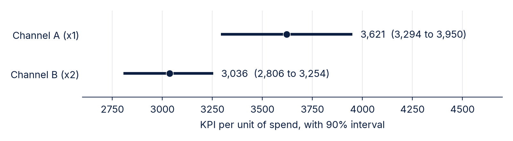
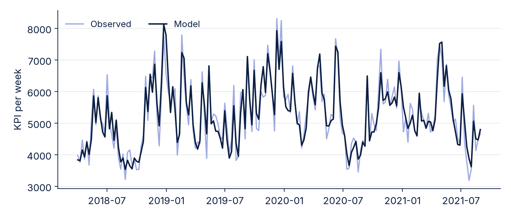

# Channel A returns more per unit of spend than Channel B

Channel A returns about 3,600 KPI per unit of spend and drives about a fifth of the KPI. Channel B returns about 3,000, but its estimate rests on 32 weeks of spend.

Example data: the pymc-marketing example dataset, 179 simulated weeks from April 2018 to August 2021. Nothing here is a finding about a real business.

## Channel A is ahead, and the intervals do not overlap

| Channel | Weeks with spend | Share of KPI | KPI per unit spend |
|---|---|---|---|
| Channel A (x1) | 179 | 21% (19–23) | 3,621 (3,294–3,950) |
| Channel B (x2) | 32 | 9% (9–10) | 3,036 (2,806–3,254) |

Channel B was off in 147 of 179 weeks, so its number comes from the 32 weeks it ran.

## The model tracks the weekly KPI closely (R² 0.90)

## This is a quick regression, not a Bayesian MMM

Weekly KPI regressed on spend with a fixed carry-over (half the effect each following week, up to 8 weeks), a trend, yearly seasonality and the two event flags. Intervals come from resampling 8-week blocks of residuals 2,000 times.

Carry-over is fixed rather than estimated, and there is no saturation, so returns at higher spend may be lower than shown.

## Next: fit the full MMM and see whether Channel A stays ahead

Fit the PyMC-Marketing MMM with saturation and estimated carry-over, then compare its channel returns with these.
