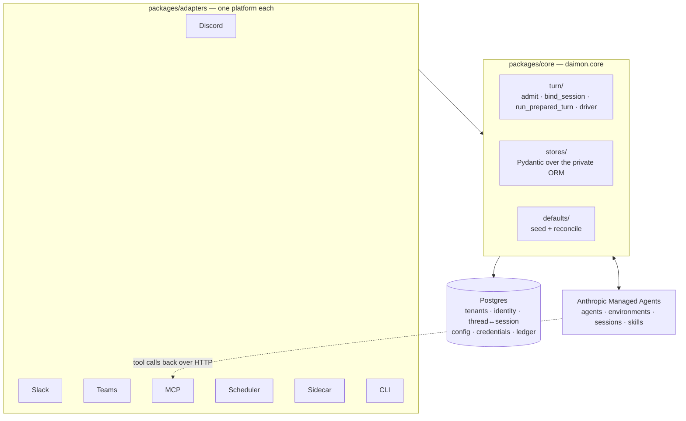

# Architecture

How Daimon is put together: the packages, the path a chat message takes to
become an agent turn, and the trust and tenancy rules that path enforces. It
is for contributors and for operators who want to know what runs where.

## What Daimon is made of

The MCP adapter is both an inbound adapter and the server the running agent
calls its tools on, so a turn started from Discord still reaches it through an
authenticated call back from the agent's sandbox.

### Packages

| Package | Path | Owns |
| --- | --- | --- |
| `daimon.core` | `packages/core/daimon/core/` | Schema and migrations, stores, the turn pipeline and pre-turn context providers. Imports no adapter. |
| `daimon.adapters.discord` | `packages/adapters/discord/` | Discord I/O, rendering, permissions, slash commands. |
| `daimon.adapters.slack` | `packages/adapters/slack/` | Slack I/O, Block Kit rendering, per-user OAuth. |
| `daimon.adapters.teams` | `packages/adapters/teams/` | Teams HTTP ingress, Adaptive Card rendering, private replies, file delivery. |
| `daimon.adapters.web` | `packages/adapters/web/` | Web app server: Discord sign-in, sessions, connection nodes, the JSON API and the built single-page app. |
| `daimon.adapters.mcp` | `packages/adapters/mcp/` | The MCP server the agent calls, plus the OAuth, webhook and hub HTTP routes. |
| `daimon.adapters.scheduler` | `packages/adapters/scheduler/` | Routine dispatch, long-job workers and maintenance sweeps. |
| `daimon.adapters.sidecar` | `packages/adapters/sidecar/` | Signed watch callbacks and poll scheduling. Runs no turns and holds no provider key. |
| `daimon.adapters.cli` | `packages/adapters/cli/` | The `daimon` admin binary. |
| `daimon.testing` | `packages/testing/` | Shared fixtures. |
| `mux` | `packages/mux/` | The provider-neutral managed-agent contract, a separate namespace. See [mux.md](mux.md). |
| `notebook_host`, `report_host` | `apps/*/src/` | Standalone services that reach Daimon over HTTP only. |

### Why the boundaries exist

`import-linter` contracts in `pyproject.toml` enforce the layout
(`uv run lint-imports`). The rules that shape most changes:

- Core never imports an adapter, and adapters never import each other. A
  change to how Slack renders a table cannot reach Discord, and core can be
  tested without a chat client.
- The ORM module `daimon.core._models` is private to `daimon.core.stores` and
  `daimon.core.defaults`. Everything else sees the Pydantic models in
  `stores/domain.py`, never SQLAlchemy rows.
- `mux` never imports `daimon`, and only each provider's own driver imports
  that provider's SDK.
- Product code never imports test harnesses.
- `notebook_host`, `report_host` and `daimon_harness` never import `daimon`.
  A service that cannot import `daimon` cannot hold the Anthropic key or a
  database credential. This is a trust boundary, not tidiness.

## How a message becomes a turn

Discord, Slack and Teams run the same three stages in `daimon.core.turn`.
Stages raise typed errors, so an adapter cannot forget a gate.

1. **`admit()`** (`turn/admission.py`) resolves identity and configuration and
   runs every pre-turn gate. It returns a frozen `Admission` holding the
   account, the agent, the environment and the resolved config.
2. **`bind_session()`** (`turn/prepare.py`) finds or creates the thread's
   session, assembles its credentials, MCP vault, repo and memory resources,
   and returns a frozen `PreparedTurn`.
3. **`run_prepared_turn()`** (`turn/run.py`) drives the session. If the
   session is gone it replaces it once, reads the old event log back into the
   new session's first message, and re-runs.

Stages two and three share one 45-minute per-turn ceiling, a backstop against
a session that never leaves `running`. `admit()` sits outside it.

### Admission order

The order is deliberate: a refused user learns nothing about the tenant's
configuration, and no provider call happens before the cheap checks.

1. Resolve the platform user to an account.
2. Refuse a reply into a channel set to `writers: none`, admins included.
3. Apply the tenant's invoker policy.
4. Resolve config through the cascade thread, channel, tenant, deployment. The
   bottom tier comes from [defaults](defaults.md). A model chosen for the
   conversation with `/model` replaces the agent's own, or falls back with a
   note.
5. Resolve the agent and environment to live provider ids, reconciling
   defaults if a tag no longer resolves.
6. Check the tenant balance, the monthly cap and the channel budget. See
   [billing](billing.md).

Each refusal carries a reason that the adapter words in its platform's nouns.
[Permissions](permissions.md) defines the access rules.

### Concurrency limits

Each adapter process limits simultaneous chat turns per tenant, and Discord
also has an optional process-wide limit. A turn over a limit joins an
in-memory queue after its progress card is posted. Tenants are served
round-robin, and a restart drops the queue. Routine and MCP turns are exempt.
A mention queued behind a turn older than three minutes gets one short notice
that it runs next.

`daimon tenants turn-cap PLATFORM WORKSPACE_ID N` overrides a tenant's limit;
`default` clears it. See
[`DAIMON_TURN_QUEUE__ENABLED`](configuration.md#daimon_turn_queue__enabled)
and
[`DAIMON_DISCORD__MAX_CONCURRENT_TURNS`](configuration.md#daimon_discord__max_concurrent_turns).

### The driver

`turn/driver.py` opens the event stream, posts the user message, and runs a
consume loop and a render loop together until the session goes idle or fails.
Turns run through the neutral ports of [mux](mux.md) by default.
[`DAIMON_TURN__PATH`](configuration.md#daimon_turn__path) switches every turn
back to the Anthropic-only path as an emergency stop.

- **Adapter hooks.** Adapters plug in through the `TurnLifecycle` protocol.
  `on_render` delivers answer text on its own task and may use the network.
  `on_sse_event` runs inline in the consume loop and must stay a cheap local
  tap.
- **Status card.** It shows the last three messages, the plan
  ([`DAIMON_PROGRESS_PLANS__MODE`](configuration.md#daimon_progress_plans__mode))
  and the tool lines. A tool line names the tool and nothing it was called
  with, except a search query, a fetched host name or a file's base name. A
  command or URL path never reaches the card.
- **Reconnection.** The stream closes cleanly about every ten minutes. After a
  silent end the driver asks the provider whether the session is still
  running, so silence is never read as a truncated success. A dropped
  connection gets a bounded two-attempt retry.
- **Billing posture.** Every call declares `Billed`, which meters each model
  request, or `BillingExempt`, which meters nothing and logs why.
- **Tool confirmation.** Every call declares what happens when the provider
  pauses a session for approval: refuse, auto-approve, or ask. With
  [`DAIMON_TOOL_SAFETY__ENABLED`](configuration.md#daimon_tool_safety__enabled)
  on, third-party writes wait for the requester on a confirmation card.
  Stopping a turn cancels a pending card, so a late Approve runs nothing.
  [Permissions](permissions.md) covers the rules.

### How a turn ended

`turn/termination.py` defines `TerminationReason`, one closed enum for every
way a turn can end: completed, stopped by the user, a named failure, the
ceiling, or a refusal before any driver ran. Every finalizer sets it before
the terminal hook fires, so lifecycle and caller agree. A session terminated
without a terminal event is never reported as completed.

`turn/notices.py` turns a reason into a short failure notice: a headline, the
cause, what survived, the next step and a request id that only admins see.

Each turn also writes a best-effort outcome row for `daimon usage turns`. It
is not an audit log.

On shutdown the Discord adapter refuses new turns, waits up to 60 seconds,
then cancels the rest. The next process delivers a finished answer or posts a
restart notice. A long turn does not survive a deploy.

### Outside text is data

Anything Daimon quotes into a turn from someone other than the requester goes
through one envelope, `core/untrusted.py`: an element marked
`trust="untrusted"`, with every value escaped. Replayed history, channel
backfill, quoted sessions and channel read tools use it. Only the
`<user_query>` is the request. Third-party MCP tool results bypass Daimon, so
the agent guidance covers them by name.

Before the message, a [context provider](context-providers.md) bound to the
channel or agent can add short cards. A failure or timeout runs the turn
without them.

## Trust model

[Permissions](permissions.md) has the rules; this section says who is exempt.

Admins are trusted; rules protect members and channels. An agent rule and a
channel's `readers` rule keep one client's context from other people, not from
an admin. So an admin is exempt only where the output reaches no one else.

| Surface | Members | Admins |
| --- | --- | --- |
| Channel, thread, handoff, routine that posts to a channel | rules apply | rules apply |
| DM (Teams personal chats included) | agent with a rule refused | agent rule exempt |
| Hub `ask` / `start_turn` / `continue_turn` | agent with a rule refused | agent rule exempt |
| Hub `continue_turn` or `ask(handle)` on a channel conversation | refused | refused: continue it in its channel |
| `fork_agent` of an agent with a rule | refused | refused |
| Agent chat, and any agent-scoped key or bearer token with no platform user | rules apply | rules apply |
| An agent key minted in a channel with limited readers, or one its agent's rule names | runs inside that channel only | runs inside that channel only |

- **One decision function.** `daimon.core.authz.authorize` decides channel
  rules, agent rules, the invoker allowlist, [agent invoker
  roles](admins.md#limit-an-agent-to-roles) and fork. Agent roles are checked
  before any admin exemption. The turn pipeline, MCP
  gates and channel, routine and handoff tools gather facts and ask it.
- **Where an agent with a rule can post.** Even on an admin's turn, only its
  rule's channels and their threads, the requester's own 1:1 DM, and direct
  messages to the requester. A channel's own agent posts only into its
  channel and the threads under it.
- **`readers: own` limits agents, not callers.** A caller with no executing
  agent, such as the CLI, may still post into such a channel.
- **Private DM sessions.** Admins never read a DM session from the hub.
- **Who counts as an admin.** See [admins](admins.md). Agent-scoped keys,
  chat-turn credentials in the hub and tokens with no platform user are never
  admins on these surfaces. Revoke an operator token to stop it at once.
- **Origins.** A tool that acts on a conversation needs its origin id and the
  calling session's own signed grant. See
  [unattended turns](unattended.md#origins).

An MCP server listed in
[`DAIMON_MCP_IDENTITY__SERVERS`](configuration.md#daimon_mcp_identity__servers)
is reached through a relay in the MCP adapter. The relay names the person to
that server in a signed token, only for a live chat session. Routines and
agent chat name nobody. The signing key stays in the MCP service. See
[mcp-servers](mcp-servers.md).

## Tenancy

One Discord server, Slack workspace or Teams organisation is one tenant. Its
UUID is derived from the platform and workspace id, so it survives database
resets. [Isolation](isolation.md) describes who owns personal, shared and
tenant data. Isolation is enforced in two places.

**In Postgres.** Tenant-scoped tables carry `tenant_id` with a cascading
foreign key, and stores take it as a parameter. Account erasure does not rely
on cascades: `core/purge.py` deletes every row that references a principal in
one transaction, and `core/privacy.py` is its read-only mirror for the
preview. A test fails when a person-scoped table joins one path and not the
other. Usage and accounting rows are kept as financial evidence.

**In the provider workspace.** One deployment runs on one provider key, so
tenant separation rides on metadata stamps such as `daimon_tenant`
(`core/defaults/metadata.py`). The resolver checks the stamp on every
cached-id lookup and rejects another tenant's id. Credentials never enter a
prompt: they are mounted as an encrypted env file or brokered per call.

The sandbox `source`s that env file, so `core/credential_env.py` quotes every
value and `core/env_file.py` limits key names. Names that steer an
interpreter, loader, git or an SDK's endpoint (`BASH_ENV`, `LD_PRELOAD`,
`*_BASE_URL`) are denied for everyone. A non-admin may add only secret-style
names ending in `_KEY`, `_TOKEN` or `_PASSWORD`.

## Sessions and Managed Agents

A turn does not create a session per message. The `thread_sessions` table maps
a tenant, platform and thread to one provider session. Its `status` is `live`,
`dead` (the provider no longer has it), `superseded` (it points at its
successor) or `retired` (an explicit fresh start). That lineage lets a thread
survive a session replacement with its context intact.

Each caller has their own row per thread. A channel configured for shared
threads instead keys the row on an owner derived from the thread, so everyone
in it uses one session with the agent's own credentials
(`core/shared_threads.py`). That session mounts a vault of the thread's own,
holding only the agent-wide MCP tokens, refreshed on each member's turn.

The provider holds the agent, environment, skills and transcript. Postgres
holds metadata: identity, the mapping above, the config cascade, credentials
and billing. A session freezes its agent spec at creation, so the mapping row
stores a `SessionSnapshot` of what it actually runs, and later turns compare
and bill against that.

### Same-thread handoff

A thread can move to another agent without a new thread. The person asks the
agent, which calls `hand_off_task`, or, after a channel's agent changes, uses
the **Switch to agent** button on the stale thread's notice.

Both call `core/thread_handoff.py`, which checks `authorize` and writes only
the new binding. The next message replaces the old session. Its transcript
carries across only if the new agent could read it from that thread.

## Entry points that are not a chat message

These paths skip `admit()` and `bind_session()` but reuse the same session
creation and driver.

- **Scheduled routines** run through `core/headless_runner.py` under the same
  ceiling. The scheduler runs the balance, cap and channel budget gates itself
  before each fire. An owner-DM routine instead runs as a live DM turn. See
  [routines](routines.md).
- **MCP agent-chat tools** drive a session directly. They re-run the balance
  and cap gates.
- **`daimon run`** is a single-turn subprocess entry that calls the driver
  directly, billing-exempt.
- **Wakes** run a turn in an existing thread with nobody mentioning the bot:
  a handoff's first turn, work unblocked by a private form, a timer, a
  finished [long job](long-jobs.md) or a [watch](watches.md) report. Each chat
  adapter polls for due wakes and dispatches them through the three stages,
  so every gate applies. A wake interrupted mid-run is never run twice.
- **Watch polls** run in the `watch-executor` service and start no turn.

Every entry point but a person's own message runs
[unattended](unattended.md). A new entry point should reuse `admit()`, not
re-derive the gate order.

## Standalone apps

- **`apps/notebook-host/`** serves published marimo notebooks, one subprocess
  per notebook behind a reverse proxy. With
  [`DAIMON_NOTEBOOK__ORIGIN_BASE`](configuration.md#daimon_notebook__origin_base)
  each notebook gets its own origin. Without it, a public host admits uploads
  only from tenants listed in
  [`DAIMON_NOTEBOOK__TENANTS`](configuration.md#daimon_notebook__tenants).
- **`apps/report-host/`** serves one published PDF report with a chat sidebar.
- **`apps/harness/`** is a FastAPI agent runtime on the OpenAI Agents SDK. It
  imports only mux wire contracts. See [providers](providers.md).

The hosts hold no Anthropic key or database credential and reach Daimon over
HTTP with capability tokens.

## Where to look in the code

| To change | Start at |
| --- | --- |
| Admission gates | `packages/core/daimon/core/turn/admission.py` |
| Session creation and reuse | `turn/prepare.py`, `core/session_preparation.py` |
| The event loop and status card | `turn/driver.py`, `turn/lifecycle.py` |
| Why a turn ended | `turn/termination.py`, `turn/notices.py` |
| Access decisions | `core/authz.py` |
| Config cascade | `core/stores/scoped_config_read.py`, `core/scope.py` |
| Web page styles | `uv run python scripts/generate_web_css.py` after editing `static/input.css` (Linux x64; CI runs it with `--check`) |

See also [routines](routines.md), [mcp-tools](mcp-tools.md) and
[configuration](configuration.md).
